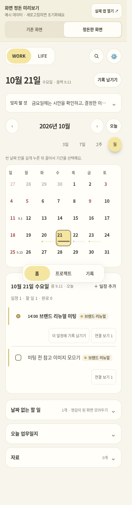
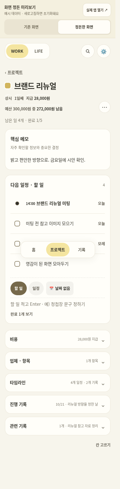
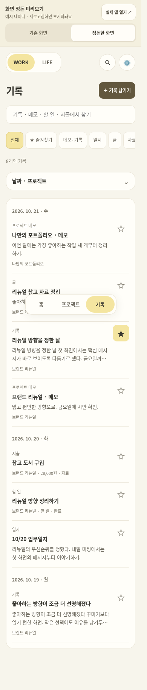

# 화면 정돈 미리보기 · 2차 · 2026-10-21

이 문서는 2차 시안의 검토 기록입니다. 이후 사용자의 반영 요청에 따라 **2026.10.21.3에 실제 앱에 적용**했습니다. [실제 앱](https://sera-kim-arec.github.io/Arecmik/?v=202610217) 또는 [현재 앱의 예시 미리보기](https://sera-kim-arec.github.io/Arecmik/preview.html?v=202610217)를 열 수 있습니다. 2026.10.21.4에서는 일정 목록의 반복 연결 버튼을 세부 화면으로 정리하고, 자료를 달력 위로 올렸으며, 기본 기록 목록에서 할 일·일정을 제외했습니다. 원래 할 일은 전용 분류·검색·즐겨찾기로 계속 찾을 수 있습니다. 2026.10.21.5에서는 PC의 달력 옆 남은 할 일, 전체 찾기, 기록 분류 위치를 정리하고 기본 기록 목록은 작성한 내용 중심으로 좁혔습니다. 2026.10.21.6에서는 읽기 대비와 중복 날짜를 정리하고, 홈 한 줄 할 일 추가와 기록 본문 우선 작성을 적용했습니다. 예시 페이지는 현재 앱 구성을 그대로 사용하며, 검토 당시의 비교 버튼은 제거했습니다.

예시 페이지는 로그인·Firebase·Android 연결을 시작하지 않으며 실제 앱의 저장소를 읽거나 쓰지 않습니다. 예시에서 수정한 내용은 새로고침하면 초기화됩니다. 실제 앱의 기존 데이터는 이관하지 않고 그대로 사용합니다. 아래 캡처는 2차 검토 시안 당시의 예시 데이터입니다.

## 제안한 변화

- 홈: **잊지 말 것**을 달력 위에 한 줄 요약으로 표시합니다. 펼치면 원래 메모를 수정할 수 있고 접힌 요약도 함께 갱신됩니다. 날짜 없는 할 일은 개수와 제목을 표시합니다. 밀린 할 일이 있으면 해당 구역은 처음부터 펼칩니다.
- 프로젝트: 핵심 메모와 다음 일정·할 일을 먼저 보여 줍니다. 지급액·예산은 상단에 남기고 비용 내역·업체·타임라인·진행 기록·관련 기록은 펼쳐서 봅니다. 접힌 줄에는 최근 기록의 날짜·내용, 연결된 글의 제목, 개수·금액을 표시합니다. 펼침 상태는 프로젝트별로 기억하며 미리보기를 새로고침하면 초기화됩니다.
- 기록: **전체 / 즐겨찾기 / 메모·기록 / 일지 / 글 / 자료 / 할 일·일정 / 지출**을 같은 분류 줄에 표시합니다. 모바일에서는 이 줄을 좌우로 스크롤할 수 있으며 즐겨찾기는 앞쪽에 배치했습니다. 메모·기록은 진행 기록·프로젝트 핵심 메모·피드백을 묶습니다. 날짜·프로젝트 조건은 별도로 펼쳐서 설정하고, 검색어·종류·즐겨찾기 조건과 함께 적용합니다.
- 쓰기: **＋ 기록 남기기** 안에서 짧은 기록·오늘의 일지·긴 글·자료를 선택합니다. 원래 편집기를 그대로 열며, 일지·글·자료 작성 화면에서 기록 전체로 돌아갈 수 있습니다.
- 목록: 종류 이름을 제목 위로 옮겨 본문 너비를 확보했습니다. 반복 안내 문장과 접힌 줄의 일반적인 설명을 줄이고, 실제 내용이 없는 줄은 비워 둡니다.
- 공통: 크림 바탕과 레몬색 선택 표시, 진회색 글자로 대비를 정리했습니다. 제목·본문·보조 설명의 크기와 구역 사이 간격을 맞췄습니다. 흑백 테마도 기존 선택 경로로 볼 수 있습니다.

전달받은 UX 검토에서 우선순위로 꼽은 세 가지를 먼저 반영한 시안입니다. 일정 행의 액션 버튼 정리와 프로젝트 머리글 요약은 후속 검토 대상으로 남겨 두었습니다.

## 검토할 질문

1. 접어 둔 정보 중 바로 보여야 할 것은 무엇인가요?
2. 홈에서 날짜 확인 → 일정 열기 → 기록 남기기가 자연스럽게 이어지나요?
3. 프로젝트에서 가장 중요한 다음 행동이 분명한가요?
4. 기록을 검색하거나 조건을 좁혀 찾는 경로가 발견하기 쉬운가요?
5. 크기·색상·여백이 구분에 도움이 되나요? 기존보다 길을 잃는 곳은 없나요?

## 화면 캡처 · 예시 데이터

### 홈

### 프로젝트 상세

### 기록

## 검증 범위

Chromium에서 실제 Pages와 같은 `/Arecmik/` 경로로 확인했습니다. 두 비교 모드 × 320·360·390·768·1365px × 세 탭의 30가지 조합과 프로젝트 상세의 모든 접힌 구역을 검사했습니다. 날짜 선택·완료 체크·메모 자동 저장·진행 기록 추가·기록 작성·검색·즐겨찾기·필터가 작동하고, 비교 모드를 전환해도 예시 내용과 펼침 상태가 유지됩니다. 2차 시안에서는 메모 요약 즉시 갱신·프로젝트별 펼침 유지·검색과 종류/프로젝트 조건의 결합·빈 결과에서 조건 지우기·일지/긴 글/자료 작성과 재조회도 추가 확인했습니다. 새로고침 초기화·실제 localStorage 미변경·외부 요청 없음도 확인했습니다. 실제 Android 기기에서의 사용성 검증은 포함하지 않습니다.

현재는 실제 앱의 편집·탐색 코드와 `app-layout.css`를 공유합니다. `python3 scripts/build-preview.py`로 같은 화면의 격리된 예시 페이지를 재생성합니다. 적용 후 검증은 `tests/test_layout.py` 및 기존 회귀 테스트에서 수행합니다.

2026.10.21.4 정돈 후 전체 회귀 테스트 118개가 통과했습니다. 일정 목록에서 세부 화면으로 들어가 기록 연결하기, 기본 목록에서 제외한 할 일의 재검색·즐겨찾기 조회, 자료의 상단 접근·정렬·공간 분리도 확인했습니다. 320·360·390·768·1365px에서 실제 앱 세 탭과 펼친 프로젝트 구역의 가로 넘침을 확인했고, 탐색만으로 기록 데이터가 바뀌지 않는 것도 확인했습니다. 현재 앱 코드에서 다시 만든 예시 페이지의 초기화·실제 저장소 분리도 확인했습니다. Firebase 대체 모듈을 사용하는 Chromium 검증이며 실제 Android 기기 검증을 대신하지 않습니다.

2026.10.21.5 PC 업무 흐름 정돈 후 전체 테스트 123개가 통과했습니다. 검색 단축키·키보드로 결과 열기·검색 복귀, PC에서 밀린 일로 이동·제목으로 상세 열기, 모바일 분류 두 줄 표시, 기록과 자료·지출의 구분을 확인했습니다. 320·360·390·768·1024·1365·1920px에서 실제 앱 세 탭과 펼친 프로젝트 구역을 확인했고, 현재 코드에서 생성한 예시 페이지의 저장소 분리·새로고침 초기화도 확인했습니다. 실제 Android 기기에서의 조작 검증은 포함하지 않습니다.

2026.10.21.6에서는 전체 테스트 126개가 통과했습니다. 홈 한 줄 입력의 실패·재시도·중복 방지·공간별 임시 입력, 한 번 눌러 기록 작성·날짜 기본값 저장, 그룹 날짜와 검색 날짜 표시를 검증했습니다. 7가지 화면 너비의 세 탭·프로젝트 상세, 320·390·1365px의 기록 편집창, 예시 페이지의 실제 저장소 분리도 확인했습니다. 좁은 화면의 날짜 입력은 한 열로 배치하고, 모바일 월 달력의 빠른 입력은 선택한 날짜의 일정 아래에 둡니다. 검증은 Firebase 대체 모듈을 쓰는 Chromium 기준이며 실제 기기 확인은 별도입니다.

2026.10.21.7에서는 WORK 기록의 지출 분류·검색 안내를 제거하고 LIFE의 지출은 유지했습니다. 기존 WORK 비용의 검색·편집 진입과 공간 전환 시 안내 갱신을 포함한 관련 브라우저 테스트 30개가 통과했습니다.
